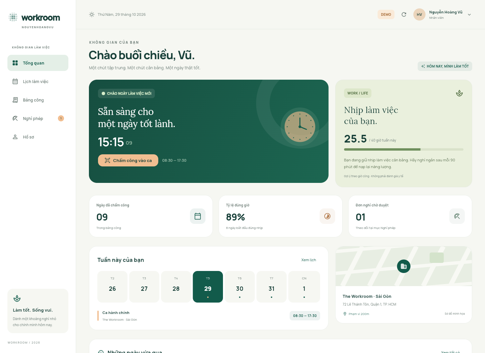

# NguyenHoangVu · Workroom

Ứng dụng **chấm công nhân viên viết bằng Flutter**, giao diện tiếng Việt cho Android/iOS. Backend FastAPI và PostgreSQL, dùng API HTTPS để truy cập từ điện thoại thật. Có cấu hình miễn phí cho đồ án cá nhân.



## Deploy miễn phí cho bài cá nhân

Dùng **Render Free + Neon Free + Brevo Free**. Không cần thuê VPS hoặc mua domain cho API. Source đã hỗ trợ OTP email qua HTTPS để tránh cổng SMTP bị Render Free chặn; `render.yaml` không còn tạo DB trả phí.

Làm theo từng bước tại **[DEPLOY_FREE.md](docs/DEPLOY_FREE.md)**. Các dịch vụ có hạn mức/duyệt tài khoản riêng; SMS thật không được bảo đảm miễn phí. Chưa có tài khoản/URL của bạn nên chưa deploy thật.

## Mở và chạy ngay

```bash
cd mobile
flutter pub get
flutter run --dart-define=DEMO_MODE=true
```

Chọn **Khám phá bản demo**. Trong **Hồ sơ → Không gian demo**, đổi giữa nhân viên, quản trị viên và khách hàng. Dữ liệu mẫu chỉnh sửa được trong phiên chạy; khởi động lại sẽ khôi phục. Không cần tài khoản dịch vụ để xem giao diện.

Nếu đã nhận thư mục `dist`, cài `dist/NguyenHoangVu-demo.apk` lên Android 7.0+; ứng dụng không yêu cầu tài khoản máy chủ để khám phá demo. APK demo không phải bản nộp kết nối API thật.

**Chạy với máy chủ thật:** làm theo [DEPLOY.md](docs/DEPLOY.md), điền `mobile/config/production.json`, sau đó:

```bash
cd mobile
flutter run --dart-define-from-file=config/production.json
```

## Đối chiếu yêu cầu đề bài

| Yêu cầu | Phần đã xây dựng |
|---|---|
| Tên project cá nhân | Thư mục `NguyenHoangVu`; tên hiển thị Android/iOS `NguyenHoangVu`; package Dart `nguyen_hoang_vu` theo quy tắc Dart |
| Mobile bắt buộc Flutter | Toàn bộ màn hình mobile dùng Flutter; có project Android/iOS, thêm Flutter Web để xem trước |
| Đăng ký email | Đăng ký → OTP email → xác minh; mật khẩu băm Argon2 |
| Đăng ký/đăng nhập bên thứ ba | Google OAuth 2.0 Authorization Code qua backend; state, mã trao đổi một lần và ràng buộc verifier ứng dụng |
| Đăng nhập + mật khẩu + OTP | Email làm tên đăng nhập; OTP email hoặc SMS Twilio; mã 6 số, 5 phút, tối đa 5 lần sai |
| Phân quyền | Admin, nhân viên, khách hàng; chuyển giao diện tương ứng và kiểm tra quyền tại API |
| CRUD | Nhân viên, chi nhánh, ca làm, phân ca, đơn nghỉ; khóa nhân viên để giữ lịch sử bảng công |
| Chấm công | Vào/ra ca theo lịch, GPS trong bán kính chi nhánh và QR ký số hết hạn sau 45 giây |
| Đăng nhập bằng khuôn mặt | Face ID do hệ điều hành xác thực trên thiết bị hỗ trợ; có vân tay trên thiết bị hỗ trợ |
| Chia sẻ vị trí | Chia sẻ một lần cho admin trong 1 giờ, dừng chủ động; chia sẻ link bản đồ bằng bảng chia sẻ hệ thống |
| QR | Admin mở QR văn phòng tự đổi; nhân viên quét bằng camera; backend xác minh chữ ký, hạn và chi nhánh |
| Tính năng đề xuất | **Nhịp cân bằng**: giờ làm tuần, giờ vượt chuẩn, tải giờ công và gợi ý nghỉ có điều kiện |
| Giao diện và cả nhóm chạy được | Thiết kế xanh ngọc/kem, font Manrope + Lora đóng gói sẵn, bố cục điện thoại/tablet/desktop, lockfile và cấu hình chung |
| API không dùng localhost khi nộp | Cấu hình API HTTPS bằng `--dart-define`; Render blueprint hoặc VPS Docker + Caddy + PostgreSQL |

**Ba mục thuyết trình:** (a) Face ID, (b) chia sẻ vị trí, (e) QR. Vân tay là lựa chọn bổ sung của cùng cơ chế sinh trắc học. Face ID không phải mô hình nhận diện ảnh selfie tự huấn luyện. Nếu giảng viên bắt buộc so khớp khuôn mặt qua camera thay vì Face ID của hệ điều hành, cần thống nhất lại tiêu chí này trước nghiệm thu.

## Trạng thái thực tế

- Source Flutter và backend đã có; demo và API thật là hai chế độ riêng, không tự giả lập OTP hoặc GPS trong chế độ API thật.
- Chưa có tài khoản Render/Neon/Brevo/Google OAuth của bạn. Project kèm cấu hình và hướng dẫn deploy miễn phí; **chưa có URL production đang hoạt động**.
- Kiểm thử tự động và bản build được ghi tại [VERIFICATION.md](docs/VERIFICATION.md).
- Cần nghiệm thu Face ID/vân tay, camera, GPS trên điện thoại thật và dịch vụ OTP/OAuth sau khi cấu hình.

## Cấu trúc

```text
NguyenHoangVu/
├── mobile/                 Flutter Android, iOS, web
│   ├── lib/core/           API, phiên đăng nhập, dữ liệu, theme, demo
│   ├── lib/screens/        Đăng nhập, dashboard, chấm công, CRUD, hồ sơ
│   ├── lib/widgets/        Thành phần giao diện và form
│   ├── assets/fonts/      Font + giấy phép, không tải font lúc chạy
│   └── config/            Mẫu API HTTPS dùng chung cho nhóm
├── backend/
│   ├── app/               FastAPI, model, xác thực, OTP, quản trị
│   └── tests/             Kiểm thử nghiệp vụ và phân quyền
├── docs/                  Deploy, kiến trúc, nghiệm thu, thuyết trình
├── deploy/Caddyfile        Reverse proxy và HTTPS cho VPS
├── compose.yaml            PostgreSQL + API + Caddy
├── render.yaml             Render blueprint
├── scripts/                Build APK, kiểm tra deploy, đóng gói source
└── .github/workflows/      CI backend + Flutter
```

## Công cụ cần có

- Flutter **3.47.4**, Dart đi kèm; Android SDK, Android Studio hoặc VS Code. Android tối thiểu API 24 theo Flutter hiện tại.
- Build iOS cần macOS + Xcode đầy đủ và cấu hình signing của Apple. Face ID cần iPhone hỗ trợ và đã đăng ký khuôn mặt.
- Backend: Python 3.11 hoặc Docker. Server thật dùng PostgreSQL; SQLite chỉ phục vụ phát triển/kiểm thử.
- Không chia sẻ `.env.production`, mật khẩu, `key.properties` hoặc file keystore qua Git. `API_BASE_URL` là cấu hình công khai, có thể chia sẻ cho cả nhóm.

## Chạy backend để phát triển

Các lệnh dưới đây chỉ kiểm thử nội bộ trên máy lập trình. Bản nộp và ứng dụng của cả nhóm phải dùng API HTTPS đã deploy.

```bash
cd backend
python3 -m venv .venv
source .venv/bin/activate
pip install -r requirements.txt
cp .env.example .env
uvicorn app.main:app --host 127.0.0.1 --port 8000
```

Windows PowerShell: tạo môi trường bằng `py -3.11 -m venv .venv`, kích hoạt bằng `.venv\Scripts\Activate.ps1`, sao chép bằng `Copy-Item .env.example .env`.

Khi `SEED_DEMO=true`, server phát triển tạo:

| Vai trò | Email | Mật khẩu phát triển |
|---|---|---|
| Nhân viên | `vu@demo.vn` | `Vu@2026Demo!` |
| Admin | `admin@demo.vn` | `Vu@2026Demo!` |
| Khách hàng | `khach@demo.vn` | `Vu@2026Demo!` |

Nếu chưa cấu hình dịch vụ email trong môi trường development, mã OTP được in ở log server, **không trả trong response**. Production bắt buộc dịch vụ email thật (Brevo HTTPS hoặc SMTP) và cấm seed demo. Dữ liệu server phát triển khác dữ liệu giao diện demo.

Swagger/OpenAPI ở đường dẫn `/docs` và `/openapi.json` của API. [API.md](docs/API.md) tóm tắt endpoint và quyền.

## Build APK kết nối API đã deploy

```bash
cp mobile/config/production.example.json mobile/config/production.json
# Sửa API_BASE_URL thành URL HTTPS thật; giữ DEMO_MODE=false.
bash scripts/build_android.sh
```

Windows:

```powershell
Copy-Item mobile/config/production.example.json mobile/config/production.json
# Sửa API_BASE_URL trước khi build.
powershell -ExecutionPolicy Bypass -File scripts/build_android.ps1
```

Script kiểm tra API public, môi trường production và endpoint được bảo vệ trước khi build. Kết quả `dist/NguyenHoangVu.apk`. Mặc định ký bằng debug key để cài thử/nộp bài. Muốn phát hành Play Store, dùng keystore riêng theo [hướng dẫn signing](https://docs.flutter.dev/deployment/android#sign-the-app), không dùng debug key.

## Kiểm tra source

```bash
cd backend
.venv/bin/python -m pytest -q
cd ../mobile
flutter analyze
flutter test
flutter build web --release --dart-define=DEMO_MODE=true --no-wasm-dry-run
```

Tài liệu tiếp theo: [Deploy](docs/DEPLOY.md) · [Kiến trúc](docs/ARCHITECTURE.md) · [API](docs/API.md) · [Nghiệm thu và thuyết trình](docs/DEMO.md).
