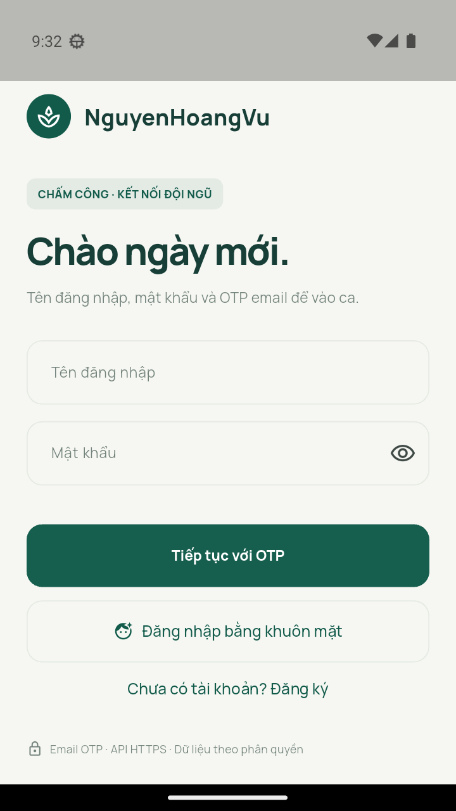

# NguyenHoangVu · Chấm công nhân viên

**Nguyễn Hoàng Vũ — MSSV 2380602586**. Ứng dụng di động Flutter, giao diện tiếng Việt xanh ngọc/kem, font Manrope và Lora đóng gói sẵn. Bản Android kết nối trực tiếp API HTTPS public, không dùng localhost hoặc dữ liệu demo khi nộp.

## Link nộp bài

| Thành phần | Địa chỉ |
|---|---|
| Frontend Flutter | https://github.com/nguyenvu2803/NguyenHoangVu/tree/main/mobile |
| Backend tích hợp | https://github.com/nguyenvu2803/NguyenHoangVu/tree/main/backend_shared |
| API public | https://nguyen-hoai-nam-2380601398-api.onrender.com/v1 |
| Health public | https://nguyen-hoai-nam-2380601398-api.onrender.com/v1/health |
| Video YouTube | Chưa có; chủ bài sẽ quay và tải lên theo `docs/KICH_BAN_VIDEO.md` |

Source đã có trên GitHub public; hai link frontend/backend mở được không cần đăng nhập. Trạng thái kiểm tra thực tế nằm trong [VERIFICATION.md](docs/VERIFICATION.md). Video bổ sung sau khi quay, tải lên và kiểm tra quyền xem.



## Chức năng bản tích hợp

- Đăng ký email, xác minh OTP; đăng nhập tên đăng nhập + mật khẩu + OTP email. OTP 6 số, hết hạn 10 phút, cooldown gửi lại và giới hạn thử sai tại backend.
- **Một APK, ba giao diện theo quyền**: nhân viên/người dùng, quản lý chi nhánh, quản trị viên. Phân quyền **admin / manager / employee**. Admin quản trị toàn bộ; manager quản lý chi nhánh; employee xem dữ liệu cá nhân. Tài khoản pending/suspended có màn hình riêng, không tự nâng quyền.
- CRUD nhân viên, chi nhánh và ca làm theo quyền. Đơn điều chỉnh công có tạo/sửa/xóa khi pending và duyệt/từ chối bởi người có quyền; giữ lịch sử công gốc.
- Chấm vào/ra ca bằng GPS mới, kiểm tra bán kính chi nhánh, sai số tối đa 100m, ca được phân và cửa sổ giờ. Máy chủ ghi thời điểm chấm công.
- **Đăng nhập khuôn mặt qua camera**: đăng ký/xóa mẫu; backend YuNet/SFace đối chiếu ảnh; sau mật khẩu + OTP, mở Cài đặt để thiết lập. Thiết bị đã thiết lập có thể quét mặt để đăng nhập không OTP. Khóa thiết bị lưu bảo mật; nhận diện 2D chưa có kiểm tra người thật. Xem [hướng dẫn](docs/SETTINGS_FACE_LOGIN.md).
- **Chia sẻ vị trí**: lấy một vị trí hiện tại, chọn hạn 15/30/60/120 phút, dừng sớm; admin/manager đọc theo quyền; mở bản đồ khi người dùng chọn. Không theo dõi nền.
- **Dịch tin nhắn realtime**: hội thoại riêng qua SSE có Bearer token; người nhận trong chi nhánh hoặc admin. ML Kit dịch Việt–Anh–Trung trên Android, tự dịch tin đến và xem trước bản nháp, giữ bản gốc. Tải mô hình lần đầu cần Internet; không cần API key trả phí. **Backend public hiện chưa có route chat mới**; chủ API triển khai theo [DEPLOY_CHAT.md](docs/DEPLOY_CHAT.md).
- QR là **tiện ích phụ, không tính trong ba chức năng nâng cao đã chọn**: tạo/hiển thị QR ca và quét bằng camera để chọn ca được phân. QR là mã chọn ca, không phải bằng chứng hiện diện hay chữ ký chống sao chép; GPS và phân quyền backend xác thực việc chấm công.
- Báo cáo tháng và xuất CSV; hiển thị thời gian hiệu lực sau điều chỉnh và thời gian thiết bị gốc.
- Đề xuất **Nhịp cân bằng**: cảnh báo khoảng nghỉ giữa ca dưới 11 giờ, ca dài hơn 10 giờ và thiếu giờ vào/ra. Chưa nghiên cứu toàn bộ thị trường để tuyên bố tính năng chưa tồn tại ở app khác.

Đề cho phép đăng ký email **hoặc** OAuth và OTP email **hoặc** SMS; bản đang kết nối dùng email + OTP email. Không ghi nhận Google OAuth/SMS là tính năng đã nghiệm thu của bản này.

## Cài APK và chạy lại

APK production: `dist/NguyenHoangVu.apk` nếu nhận gói bàn giao hoặc tự build theo lệnh dưới. APK ký debug key để cài/nộp đồ án, chưa phải chữ ký phát hành Play Store. Yêu cầu Android API 24 trở lên.

```sh
cd mobile
flutter pub get
cp config/production.example.json config/production.json
flutter run --dart-define-from-file=config/production.json
```

Mẫu đã điền đúng API chung, giữ `DEMO_MODE=false`, `SHOW_DEMO=false`, `ALLOW_INSECURE_DEV=false`. Không ghép thêm `/v1` vào endpoint. Flutter được kiểm tra với phiên bản 3.47.4.

Build từ thư mục project:

```sh
bash scripts/build_android.sh
```

Windows: `powershell -ExecutionPolicy Bypass -File scripts/build_android.ps1`. Script kiểm tra HTTPS/health và auth trước khi build. Bản demo cũ `dist/NguyenHoangVu-demo.apk` không phải bản nộp.

## Đăng ký trên API chung

1. Nhập họ tên, tên đăng nhập 3–32 ký tự thường/số/`_`/`.`, email thật và mật khẩu 10–128 ký tự.
2. Nhập OTP nhận qua email; xác thực xong tài khoản có trạng thái pending.
3. Chủ quản trị API chung duyệt active và gán chi nhánh. Quản trị viên cần quyền hợp lệ để tạo hoặc phân ca.
4. Đăng nhập lại bằng mật khẩu + OTP. Không có tài khoản admin hoặc OTP mặc định trong source.

Mật khẩu/OTP do chủ tài khoản tự nhập, không gửi qua Git/chat. Thiếu tài khoản active thì chưa nghiệm thu được CRUD/chấm công trên API chung.

## Source backend và deploy

`backend_shared/` là **Node.js/Express + PostgreSQL** đã lấy từ backend nhóm 8. Ghi nguồn/commit và thay đổi tại [INTEGRATION_NGUYENHOANGVU.md](backend_shared/INTEGRATION_NGUYENHOANGVU.md). Backend dùng chung được phép theo đề; không nhận source của người khác là tự viết toàn bộ.

API public hiện do chủ backend chung vận hành; các sửa cục bộ chưa được deploy lên dịch vụ đó. Có thể deploy bản riêng miễn phí bằng root `render.yaml`, Neon PostgreSQL Free và email relay HTTPS; xem [DEPLOY_FREE.md](docs/DEPLOY_FREE.md). Không cần VPS/domain trả phí. Không tự chọn gói trả phí.

Thư mục `backend/`, `compose.yaml`, `.env.production.example`, `deploy/` và tài liệu `docs/legacy/` thuộc bản FastAPI ban đầu, được giữ để tham khảo; **không dùng cho APK production hiện tại**. Không dùng test hoặc screenshot demo cũ làm bằng chứng kiểm thử API chung.

## Kiểm tra và bàn giao

```sh
python3 scripts/check_deployment.py
cd backend_shared
npm ci
npm run models:fetch
npm test
cd ../mobile
flutter analyze --no-pub
flutter test --no-pub
```

Từ root, `python3 scripts/test_backend_integration.py` chạy Dart API client gọi Express thật với pg-mem/mailbox tách biệt, bao gồm OTP, phân quyền, CRUD, GPS payload, mặt, gửi/nhận chat qua SSE, báo cáo và đăng xuất. Test chờ cooldown OTP 61 giây; đây không phải phép thử OTP email hay GPS phần cứng production. Cần Node.js >=22 trên PATH và model đã tải.

Kiểm thử mô hình dịch thật trên Android: `cd mobile && flutter test integration_test/translation_test.dart -d emulator-5554`. Lần đầu tải mô hình cần mạng và có thể mất vài phút.

Backend cần Node.js >=22. Khi cài có thể đặt `ONNXRUNTIME_NODE_INSTALL=skip` để dùng CPU, không tải CUDA. Test backend dùng pg-mem/mailbox riêng và model mặt thật; không gửi OTP thật, không thay thế kiểm tra PostgreSQL/thiết bị production.

- [Hồ sơ cá nhân và điểm dự kiến](hovaten.txt)
- [Kịch bản quay video](docs/KICH_BAN_VIDEO.md)
- [Danh sách nộp bài](docs/NOP_BAI.md)
- [Bảng kiểm thử](docs/QA_INVENTORY.md)

Không đóng gói `.env`, token, mật khẩu, keystore, account Postman riêng hoặc model tải về vào Git/source ZIP.

## Cài đặt bản 1.3.0+4

Cài đặt có cỡ chữ 85–130%, bốn màu nền, camera đối xứng, sửa họ tên/điện thoại/giới thiệu qua API. Xem `docs/SETTINGS_FACE_LOGIN.md` cho luồng quét mặt không OTP, migration 006 và giới hạn. Backend public cũ chưa có tính năng mới khi chưa deploy.
