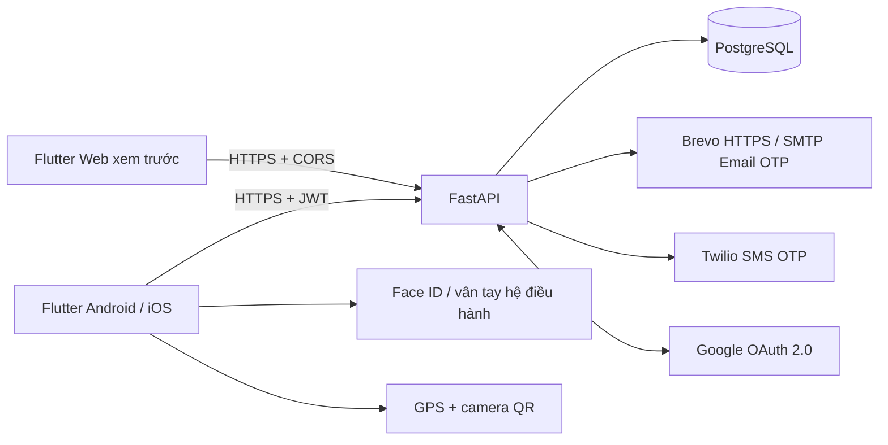
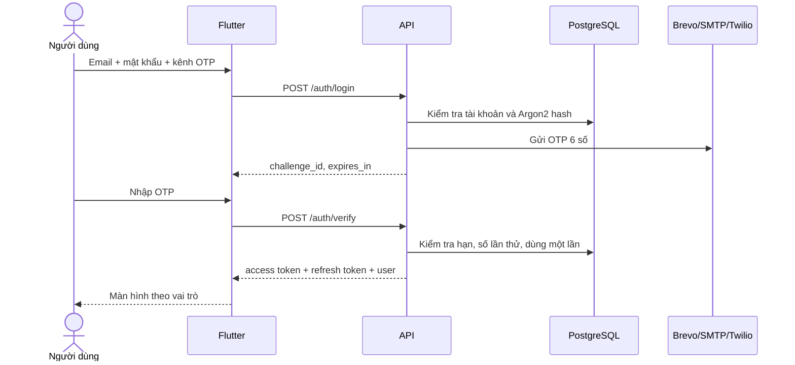

# Kiến trúc và nghiệp vụ

## Thành phần

Access token tồn tại trong bộ nhớ 15 phút. Refresh token ngẫu nhiên 30 ngày được hash trong DB, dùng một lần khi refresh, lần tiếp theo nhận token mới. Chỉ khi người dùng bật sinh trắc học, refresh token mới được lưu vào secure storage trên thiết bị. Không lưu mật khẩu, OTP, ảnh khuôn mặt hay vân tay vào app storage.

## Luồng đăng nhập

Đăng ký email tự nhận quyền `customer`. Admin mới có thể cấp quyền nhân viên/quản trị. Việc ẩn menu chỉ phục vụ giao diện; API luôn kiểm tra người dùng đang hoạt động, đã xác minh và có quyền tương ứng.

OTP và refresh token được tiêu thụ bằng câu lệnh update/delete có điều kiện để tránh dùng lại song song. Rate limit xác thực lưu trong DB, 30 yêu cầu/phút theo địa chỉ kết nối API; reverse proxy có thể khiến nhiều người dùng dùng chung giới hạn này. Với tải lớn cần cấu hình proxy tin cậy và limiter phù hợp.

## Sinh trắc học

Người dùng đăng nhập OTP trước, chọn bật Face ID/vân tay và xác thực với hệ điều hành. Khi mở lại, `local_auth` yêu cầu sinh trắc học trước khi app dùng refresh token từ secure storage để lấy phiên mới.

**Khóa ứng dụng** giữ phiên thiết bị đã đăng ký; **Đăng xuất** thu hồi refresh token và xóa thông tin sinh trắc học của app. Sinh trắc học chỉ hỗ trợ native, không chạy trên Flutter Web demo. Android hỗ trợ khuôn mặt hay không phụ thuộc phần cứng và chính sách biometric của hệ điều hành; nghiệm thu mục khuôn mặt bằng iPhone có Face ID là cách rõ nhất.

Đây là mở khóa phiên bằng sinh trắc học do hệ điều hành cung cấp. Backend không nhận bằng chứng ký từ phần cứng và không so khớp khuôn mặt qua camera. Mô hình này không phải cơ chế chống thiết bị root, app bị sửa hoặc đánh cắp token hoàn chỉnh. Muốn bảo đảm cao hơn cần hardware-bound key, attestation và thiết kế thêm phía server.

## Luồng chấm công

1. Nhân viên phải có phân ca cho ngày hiện tại theo `Asia/Ho_Chi_Minh`.
2. QR được admin cấp cho chi nhánh, ký HS256, có loại token riêng và thời hạn 45 giây. Màn hình QR tự đổi trước khi hết hạn.
3. Flutter lấy vị trí mới trước khi gửi, từ chối GPS mock do thiết bị báo và độ chính xác quá thấp.
4. API kiểm tra quyền, lịch ca, đơn nghỉ đã duyệt, loại token, chữ ký, hạn QR, chi nhánh và khoảng cách Haversine.
5. Chỉ cho vào ca trước giờ bắt đầu tối đa 2 giờ. Thời điểm và số phút đi trễ lấy từ server.
6. Mỗi người một bản ghi/ngày, bảo vệ bằng unique constraint. Vào lại hoặc ra ca hai lần bị chặn.
7. Ra ca cần GPS + QR mới. Bảng công đã ghi nhận không cho sửa trực tiếp qua API CRUD.

GPS từ client có thể bị giả mạo ngoài khả năng phát hiện của app. QR hết hạn ngắn giảm nguy cơ dùng ảnh chụp cũ nhưng không chặn tuyệt đối việc chuyển QR tức thời. Bản đồ trên dashboard là sơ đồ minh họa; vị trí thật chia sẻ được mở bằng Google Maps.

Bản v1 hỗ trợ ca trong ngày, một ca mỗi nhân viên/ngày, đơn nghỉ nguyên ngày. Ca qua đêm/nhiều ca một ngày/phép theo giờ cần mở rộng model. Đơn làm từ xa hiện không tự miễn điều kiện GPS văn phòng.

## CRUD và dữ liệu

- `users`: thông tin nhân viên/khách hàng, vai trò, mật khẩu hash, trạng thái. Xóa nhân viên là khóa tài khoản để bảo toàn lịch sử.
- `branches`: tọa độ, bán kính và địa chỉ văn phòng.
- `shifts`: giờ làm và nghỉ, thuộc chi nhánh.
- `assignments`: nhân viên + ngày duy nhất + ca.
- `attendance`: vào/ra ca, khoảng cách, vị trí, độ chính xác, số phút trễ.
- `leaves`: đơn nghỉ chờ duyệt/đã duyệt/từ chối. Chỉ chủ đơn được sửa/xóa khi pending. Admin không tự duyệt đơn của mình.
- `location_shares`: ảnh chụp vị trí có chủ đích, hết hạn sau 1 giờ. Dừng chia sẻ xóa dữ liệu; API loại bản ghi hết hạn trước khi trả admin.
- `audit_logs`: thao tác quản trị, chấm công, chia sẻ vị trí và đăng nhập.

Quan hệ DB chặn xóa chi nhánh/ca còn được tham chiếu. Không cho đổi/xóa phân ca đã có bảng công. Thông tin vai trò được đọc từ DB mỗi request, nên khóa tài khoản có hiệu lực với cả access token chưa hết hạn.

## Nhịp cân bằng — tính năng đề xuất

Đây là ý tưởng bổ sung cho đồ án, không khẳng định chưa từng xuất hiện ở mọi ứng dụng trên thị trường.

- Tổng phút làm trong tuần: thời gian ra trừ vào, trừ phút nghỉ theo ca; ca đang mở dùng thời gian hiện tại.
- Giờ vượt chuẩn: tổng phần vượt 8 giờ của từng ngày.
- Tải giờ công: tổng phút tuần chia 2.400 phút, giới hạn thanh hiển thị ở 100%.
- Khi làm thêm từ 2 giờ: gợi ý trao đổi nghỉ bù; khi tổng tuần vượt 40 giờ: gợi ý xem lại lịch; ca đang mở: gợi ý nghỉ ngắn sau mỗi 90 phút.
- Dùng chính bảng công nên không cần API AI hoặc trả phí. Chỉ gợi ý, không tự duyệt phép, chấm điểm năng suất hoặc chẩn đoán sức khỏe.

Các gợi ý hiện xuất hiện trên dashboard, chưa có push notification nền. Có thể thuyết trình bằng dữ liệu kiểm thử chứa nhiều ca dài; không cần gán nhãn AI cho logic có điều kiện này.

## Triển khai miễn phí cho bài cá nhân

API trên Render Free, DB Neon Free và email Brevo Free qua HTTPS. `MAIL_PROVIDER=brevo` chọn provider HTTP; `MAIL_PROVIDER=smtp` giữ cách gửi STARTTLS cho hosting cho phép. Lỗi provider trả 503, không cấp phiên xác thực và không fallback sang OTP log trong production. Xem [DEPLOY_FREE.md](DEPLOY_FREE.md) để cấu hình.
